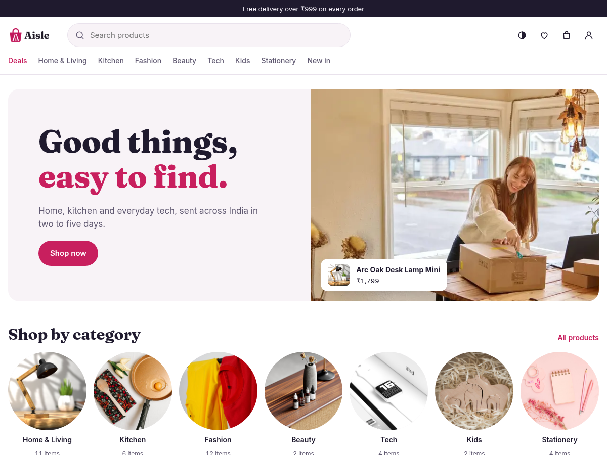

# Aisle

A shop theme for Shopclass. It is phone-first, with search, deals, filters and a clear product page. It reads its data from the Shopclass API and has a light and a dark scheme.

## Requirements

- Shopclass 7.1.0 or later, in shop mode
- PHP 8.2 or later
- No required plugins. These are recommended: `shipping`, `tax`, `promotions`, `razorpay`, `shop-emails`, `analytics`, `digital-goods`.

## Install

1. Download `aisle_X.Y.Z.zip` from the [releases](https://github.com/mindstellar/theme-aisle/releases).
2. Go to **Appearance → Manage themes** and upload the zip.
3. Click **Activate**.

Or copy this folder to `oc-content/themes/aisle/`. There is no build step.

## Set up

1. Go to **Appearance → Aisle** and set the look:
   - **Colour scheme**: follow the visitor's device, light or dark.
   - **Brand colour**: Raspberry, Ocean, Forest, Marigold or Plum.
   - **Fonts**: Bricolage + Figtree, Fraunces + Inter, or System fonts.
   - **Logo**, **Logo on dark** and **Logo height**. Without a logo, the shop name shows.
   - **Announcement bar**: one line above the header. Leave it empty to hide it.
2. Under **Catalogue**, fill in **Filters by option**: one line per option, values after a colon, for example `Colour: Sunflower, Cherry, Navy`. Up to 3 options and 10 values each. A `Colour` option shows as swatches.
3. Under **Footer**, fill in **Footer note** and **Ways to pay** (tags, separated by commas).
4. Go to **Appearance → Customise** to edit the home page with a live preview. Add, hide, move and edit sections. Changes stay a draft until you press **Publish**. **Discard** drops them.
5. Go to **Settings → Billing** and turn billing on. Set the currency, bank transfer or cash on delivery (or a gateway plugin), and on the Shop tab the delivery charge, free-over amount and hold days.

**Appearance → Manage widgets** does the same for the home sections, with an eye button to hide each one.

## Features

- Home sections: Hero banner, Category row, Products (deals, newest or one category, as a grid or a row), Promise row, Banner, Featured product, Reviews, Newsletter, and the core Rich text block.
- Cart drawer on every page. `/checkout` needs a signed-in shopper and JavaScript. Prices, totals and stock come from the server.
- Wishlist at `/wishlist`. Signed out, it stays in the browser and joins the account at sign-in.
- Product reviews with a star rating, a comment, or both. Posting needs a sign-in.
- Orders at `user/orders` and `/orders/<id>`. Paid digital files show a Download button when the `digital-goods` plugin is on with the "buyer" access rule.
- The newsletter form sends nowhere until a plugin sets its address with the `aisle_newsletter_action` filter.
- Each page prints a JSON block (`#aisle-page`). `js/aisle-track.js` turns it and the cart into GA4-named events (`view_item`, `add_to_cart`, `purchase` and others) on `window.aisleTrack` and the `aisle:track` document event. It sends nothing itself. The `analytics` plugin listens to them.

Without a recommended plugin the theme still works:

| Plugin | Adds | Without it |
|---|---|---|
| `shipping` | PIN code check, delivery date, Express, zones | Core's flat delivery charge |
| `tax` (and `tax-gst` for India) | "Includes GST" note, tax rows, tax invoice | No tax shown |
| `promotions` | Coupon field, automatic offers | A code is ignored |
| `razorpay` | Card, UPI, net banking | Bank transfer and cash on delivery |
| `digital-goods` | Downloads on paid orders | No downloads |

## Customising

The theme owns its CSS and JS in `css/` and `js/`. To change it, use a child theme or edit those files. The logo source is in `src/logo/`, with a guide to make your own in the same style. The brand colour, scheme and font come from fixed lists, so other stored values are ignored.

## For developers

- Hooks: the theme fires `header` and `footer`, and shows the `footer` widget area.
- Strings use the text domain `aisle`. Run `npm install` once, then `npm run i18n` to write `languages/aisle.pot` and `languages/en_US/theme.po`.
- Tests are in `tests/`.
- A `vX.Y.Z` tag runs `.github/workflows/release.yml`, which builds `aisle_X.Y.Z.zip`. The tag must match `Version` in `index.php`.

## Support

Report problems at [github.com/mindstellar/theme-aisle/issues](https://github.com/mindstellar/theme-aisle/issues).

## License

GPL-3.0-or-later. Copyright Navjot Tomer (Mindstellar) and contributors.
